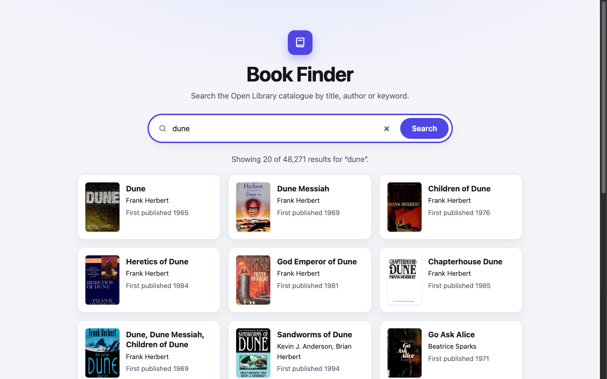

# Book Finder

A small web app that searches the [Open Library](https://openlibrary.org/) catalogue and shows title, authors, first publication year and cover for each match.



## Features

- Search by title, author or keyword; the button and the Enter key both submit the form
- Result cards with cover, title (linked to the book's Open Library page), authors and first publication year
- Up to 20 results per search, with the total number of matches above the list
- Separate messages for input that is too short, no matches, and a failed or timed-out request
- Responsive layout for desktop and phone

## Tech

- HTML, CSS and JavaScript (ES modules), no framework and no dependency
- `fetch` with `async`/`await`, `AbortController` for timeouts and for replacing a running search
- [Open Library Search API](https://openlibrary.org/dev/docs/api/search) for the data, [Open Library Covers API](https://openlibrary.org/dev/docs/api/covers) for the images. Neither needs an API key.

## How to run

Open the live version: **[aaronkuy.github.io/book-finder](https://aaronkuy.github.io/book-finder/)**

Or run it locally. There is no build step, but the page loads its script as an ES module, and browsers do not load modules from `file://`. Serve the folder instead:

```bash
git clone https://github.com/aaronkuy/book-finder.git
cd book-finder
python3 -m http.server 8000
# then open http://localhost:8000
```

## Tests

`books.js` holds the parts that do not need a browser: building the request URL and mapping a search result to what a card shows. They are tested with Node's built-in test runner (Node 20 or newer):

```bash
npm test
```

The same command runs in GitHub Actions on every pull request. The DOM code in `script.js` has no automated tests.

## How it works

- `index.html`: a search `<form>`, one line for status messages, one for errors, and an empty list for the results
- `books.js`: `buildSearchUrl()` encodes the search term with `URLSearchParams` and asks only for the fields the page shows; `toBook()` gives every optional field a fallback
- `script.js`: sends the request, checks `response.ok`, and builds the cards with `createElement` and `textContent`, so catalogue text is never interpreted as HTML

## Limitations

- Only the first 20 matches are shown; there is no paging
- The search term goes to Open Library as it is. A few inputs that Open Library's query syntax rejects (for example a lone `AND`) end in the generic error message
- Open Library is a free service and is sometimes slow. A request is given up after 15 seconds

## Notes

Until November 2026 this app used the Google Books API with an API key in the client-side code. A key in code that ships to the browser is public, so the app was moved to a data source that needs none. The old keys are still visible in the commit history.

Book data and covers come from Open Library, a project of the Internet Archive.

## License

[MIT](LICENSE)
