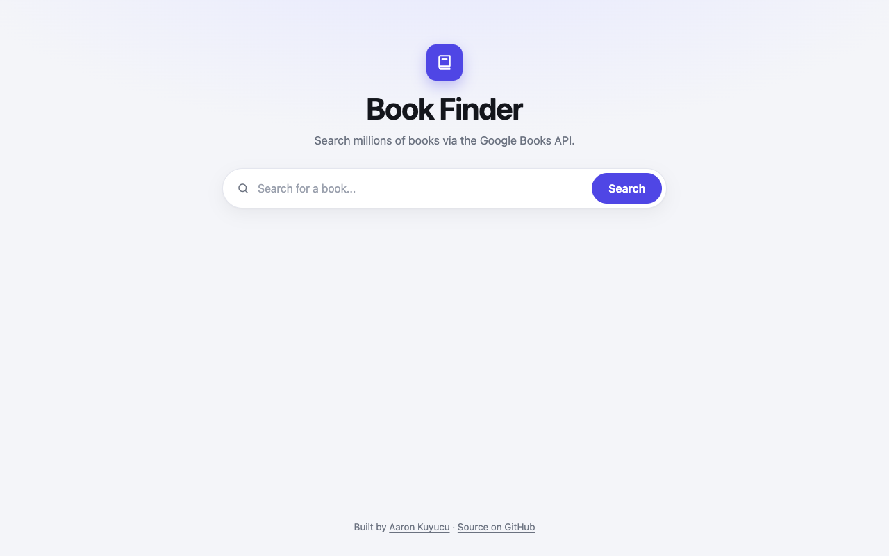

# Book Finder

A small web app that searches books through the Google Books API and shows title, author, cover and a short description.



## Features

- Search by title or keyword, with a message for empty input
- Result cards with title, authors, cover and the first 150 characters of the description
- "No books found" state and error handling around the request
- Responsive layout for desktop and phone

## Tech

- HTML, CSS, vanilla JavaScript
- `fetch` with `async`/`await`
- Google Books API (`volumes` endpoint)

## How to run

Open the live version: **[aaronkuy.github.io/book-finder](https://aaronkuy.github.io/book-finder/)**

Or run it locally. There is no build step and no dependency:

```bash
git clone https://github.com/aaronkuy/book-finder.git
cd book-finder
open index.html        # macOS; on Linux use xdg-open, on Windows start
```

## What I learned

- My first work with an external API: building the request URL, parsing JSON, handling missing fields
- `async`/`await` and `try`/`catch` around network calls
- Rendering a list of results into the DOM

## What I'd do next

- Encode the query with `encodeURIComponent` and add paging
- Show a loading state while the request runs
- Build result cards with DOM methods instead of `innerHTML`

## Notes

Uses a client-side API key restricted to this site; for production the key would sit behind a small proxy. Searching from a local `file://` copy is therefore blocked by Google; use the live version.

## License

See [LICENSE](LICENSE).
